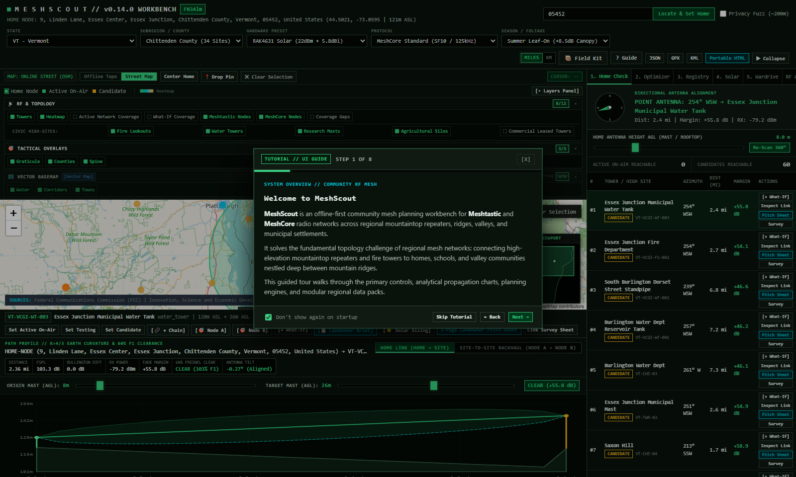

# MeshScout

[](https://github.com/meshscout-project/meshscout/actions/workflows/test.yml)
[](https://opensource.org/licenses/MIT)
[](https://www.python.org/downloads/)

MeshScout is an offline-first high-site, tower catalog, and topology planning engine for LoRa, Meshtastic, and MeshCore disaster networks across North America.
It identifies line-of-sight relays, visualizes terrain-masked viewsheds, tracks commercial and civic structures, and determines optimal repeater placements to bridge mountain terrain RF shadows.



## Architecture: Functional Core and Imperative Shell

MeshScout enforces a strict Functional Core and Imperative Shell separation across all modules.
Every mathematical, propagation, and optimization routine runs without file or network I/O.
All modules exchange validated Pydantic v2 schemas in WGS84 (`EPSG:4326`) coordinates and `Result[T]` containers.

### Functional Core Modules (`meshscout.core`)

- `contracts.py`: Defines `Coordinate`, `RegionalBounds`, `SiteCandidate`, `ElevationProfile`, `RadioConfig`, `LinkBudgetResult`, and `Result[T]`.
- `fresnel.py`: Computes First Fresnel Zone clearance and Earth curvature bulge under $k=4/3$ atmospheric refraction.
- `itm.py`: Implements the Longley-Rice ITM point-to-point preprocessor (`qlrpfl`) and Bullington knife-edge diffraction (`ITU-R P.526`).
- `viewshed.py`: Evaluates point-to-multipoint radial viewsheds across target valley grids without external GIS dependencies.
- `optimizer.py`: Solves the weighted minimum set-cover problem to cover target basins with minimal repeater cost.
- `scorer.py`: Scores civic access viability and detects 850-940 MHz front-end LNA overload requiring bandpass cavity filters.
- `presets.py`: Provides Meshtastic and MeshCore protocol profiles, radio hardware presets, and seasonal foliage attenuation models.
- `registry.py`: Manages the SQLite WAL `LivingMeshRegistry`, last-used location persistence, and 360-degree home reach analysis.
- `tower_registry.py`: Versioned SQLite spatial index (`SCHEMA_VERSION = 2`) utilizing R*Tree virtual tables (`towers_rtree`) and zoom-adaptive grid-cell decimation.
- `regulatory.py`: Evaluates advisory conducted power, antenna gain, and EIRP limits under FCC Part 15.247 (US) and ISED RSS-247 (Canada) for 902-928 MHz ISM band operation.
- `packs.py`: Regional pack export, reference-counted installation/uninstallation, SHA256 integrity verification, and manifest generation.
- `solar.py`: Simulates winter peak sun hours, sub-zero BMS charging lockout, and battery chemistry resilience (LTO vs LiFePO4).
- `telemetry.py`: Parses Meshtastic wardriving CSV/JSON packet logs and auto-calibrates empirical clutter loss against Longley-Rice models.
- `archetypes.py`: Defines authoritative community deployment archetypes (Alpine Summit, Civic Infill, Rooftop Base, Vehicular, Handheld) with cross-protocol split-horizon rules.
- `composite_viewshed.py`: Multi-origin composite viewshed polygon union calculation, area estimation, and intersite backhaul link matrix.
- `corridor.py`: Multi-hop linear backhaul corridor evaluation, cumulative distance, bottleneck link identification, and end-to-end RF feasibility.
- `staging.py`: Offline region boundary expansion, DEM tile estimation, and field-kit staging.

### Imperative Shell, Adapters, and Web Workbench (`meshscout.adapters`, `meshscout.web`)

- `regions.py`: Full North American catalog of all 65 jurisdictions (50 US States + DC/PR + 13 Canadian provinces and territories), normalization, and bounds resolution.
- `elevation.py`: Samples local USGS 3DEP GeoTIFF rasters and falls back to synthetic regional terrain models with canonical terrain provenance tags.
- `source_fetch.py` & `tower_ingest.py`: Zero-trust national ingest pipeline with dataset catalog (`sources.json`) for FCC ASR, Canadian ISED SMS, and VCGI civic towers.
- `pack_client.py` & `pack_builder.py`: HTTPS regional pack client with local file caching and CI GitHub Actions packaging engine.
- `vt_vcgi.py`: Ingests Vermont VCGI public structures, mountain peaks, fire lookouts, and municipal water towers.
- `vt_counties.py`: Provides offline high-site candidate fixtures and bounding boxes across all 14 Vermont counties.
- `generic_osm.py`: Parses offline OpenStreetMap Overpass JSON fixtures for communication towers, water towers, and agricultural silos.
- `fcc_asr.py` & `fcc_asr_bulk.py`: Ingests FCC Antenna Structure Registration (ASR) bulk archives and high-power 850/900 MHz emitter records.
- `ised_sms.py`: Ingests Canadian Innovation, Science and Economic Development (ISED) Spectrum Management System tower databases.
- `geocoder.py`: Resolves ZIP codes, towns, and coordinates with 200-meter privacy grid snapping and Maidenhead locators.
- `reporting.py`: Exports RFC 7946 GeoJSON payloads, Markdown dossiers, 1-page Landowner Pitch Sheets, and portable HTML reports.
- `web/app.py`: Serves the cloud-ready FastAPI REST API, region management, pack downloads, interactive split-pane map, and SVG Fresnel workbench.

## Installation

Clone the repository and install with web workbench and test dependencies:

```bash
git clone https://github.com/meshscout-project/meshscout.git
cd meshscout
python -m venv .venv
# On Windows: .venv\Scripts\activate
# On Linux/macOS: source .venv/bin/activate
pip install -e ".[web,dev]"
```

Verify your installation:

```bash
meshscout --help
```

## Interactive Web Workbench, CLI, and MCP Server Usage

Launch the local interactive web workbench, run CLI subcommands, or start the stdio MCP server:

```powershell
# Launch the interactive web workbench on http://127.0.0.1:8080
meshscout serve --host 127.0.0.1 --port 8080

# List North American jurisdictions and installed tower packs
meshscout regions list --country US
meshscout packs list

# Download and install regional tower packs
meshscout packs install VT NH NY CA_QC

# Ingest raw tower data sources
meshscout towers ingest fcc_asr --input data/fcc.zip --region VT
meshscout towers ingest ised_sms --input data/ised.csv --region CA_QC

# Run the complete test suite
pytest tests -v

# Start the MeshScout Model Context Protocol (MCP) server
meshscout mcp --stdio
```

### Model Context Protocol (MCP) Interface

MeshScout provides a Day-0 compliant JSON-RPC 2.0 MCP server exposing:
- **14 Tools**: `scout_repeater_sites`, `evaluate_link_budget`, `inspect_site_feasibility`, `advise_node_role_and_airtime`, `recommend_backhaul_architecture`, `provision_node_radio`, `simulate_winter_solar_survival`, `analyze_mesh_coverage_gaps`, `calibrate_empirical_clutter`, `generate_landowner_brief`, `stage_offline_field_kit`, `manage_living_mesh_state`, `advise_eirp`, `list_region_packs`.
- **8 Resources**: `meshscout://sites/all`, `meshscout://presets/hardware`, `meshscout://presets/protocols`, `meshscout://state/living-mesh`, `meshscout://fixtures/vt_counties`, `meshscout://presets/site-architectures`, `meshscout://regulatory/north-america`, `meshscout://packs/installed`.
- **3 Prompts**: `design_regional_emergency_backbone`, `audit_channel_contention`, `prepare_selectboard_pitch`.

## Regional Tower Packs Pipeline

MeshScout distributes offline regional tower packs covering 65 North American jurisdictions.
Packs span 50 US States, DC, PR, and 13 Canadian provinces and territories.
Each pack packages towers into a standalone SQLite database with an R*Tree index (`towers_rtree`) compressed with gzip.

### Upstream Datasets

1. **FCC Antenna Structure Registration (ASR)**: Ingests weekly bulk archives (`r_tower.zip`) streaming `RA.dat`, `CO.dat`, and `EN.dat`. Preserves native meter heights for structures over 15 meters AGL.
2. **Canadian ISED Spectrum Management System (SMS / TAFL)**: Ingests Technical Agricultural and Frequency Licensing (`TAFL_LTAF.zip`) 61-column records. Uses $O(1)$ 1-arcsecond spatial collapse to group multi-frequency co-located transmitters.
3. **OpenStreetMap Civic High Sites**: Queries municipal water towers, fire lookouts, communication masts, and silos via tiled Overpass QL. Applies 50-meter spatial suppression against FCC and ISED structures to prevent duplicate records.

### Automated Monthly CI Release Workflow

- **Automated Workflow**: A scheduled GitHub Actions workflow (`build-region-packs.yml`) triggers monthly builds.
- **Fail-Closed Plausibility Floors**: Builds validate row counts against `data/pack_floors.json` before exporting packs. Any floor failure halts the release.
- **Release Publishing**: Validated `.sqlite.gz` archives and `manifest.json` publish directly to GitHub Releases.

### Integrity Verification and Pack Management

- **SHA-256 Verification**: `PackClient` downloads archives over HTTPS, validates redirect targets against allowed host origins, and verifies SHA-256 checksums before installing.
- **Workbench Management**: Tab 8 ("Regional Packs") in the web workbench enables one-click pack downloads, uninstalls, and viewport fitting.
- **CLI Commands**: Manage packs via `meshscout packs list`, `meshscout packs install <REGIONS...>`, and `meshscout packs remove <REGIONS...>`.

## Data Licensing and Attribution

MeshScout aggregates open and public domain datasets under their respective upstream licenses:

- **FCC ASR**: United States Government work in the public domain.
- **Canadian ISED TAFL**: Contains information licensed under the Open Government Licence - Canada.
- **OpenStreetMap High Sites**: Data copyright OpenStreetMap contributors, licensed under the Open Data Commons Open Database License (ODbL 1.0). The web workbench renders attribution chips when civic records are visible.

## Intellectual Lineage and Provenance

MeshScout was built 100% using [StigmeRig](https://github.com/stigmerig-project/stigmerig), a sovereign local-first multi-agent coordination engine. Every feature, test, and regional pack was planned, implemented, and verified through autonomous agent swarms coordinated by StigmeRig.

MeshScout and StigmeRig build upon foundational concepts across biology, distributed systems, and agent architecture:

- **Stigmergic Coordination**: Grounded in Pierre-Paul Grasse's biological formulation of indirect coordination through shared environmental state.
- **Task Queue Architecture**: Adapted from the Open Engine pattern popularized by Nate B Jones.
- **Multi-Agent Swarm Topologies**: Informed by OpenRig research from Marcus Schwarz (`@mvschwarz`) and Mike (`@FeralMachine`).
- **Context Boundaries**: Influenced by Jake Van Clief's Interpretable Context Model (ICM).
